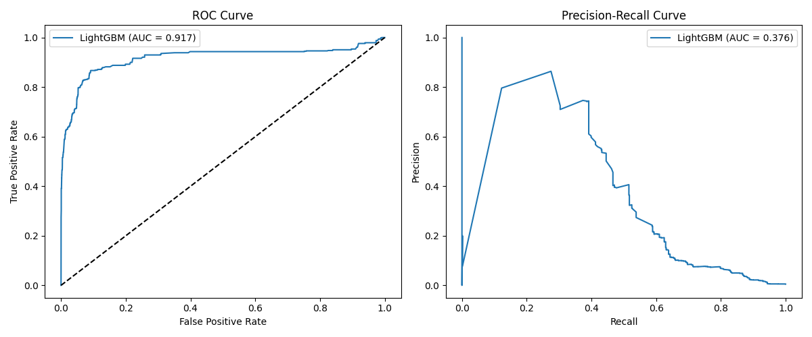
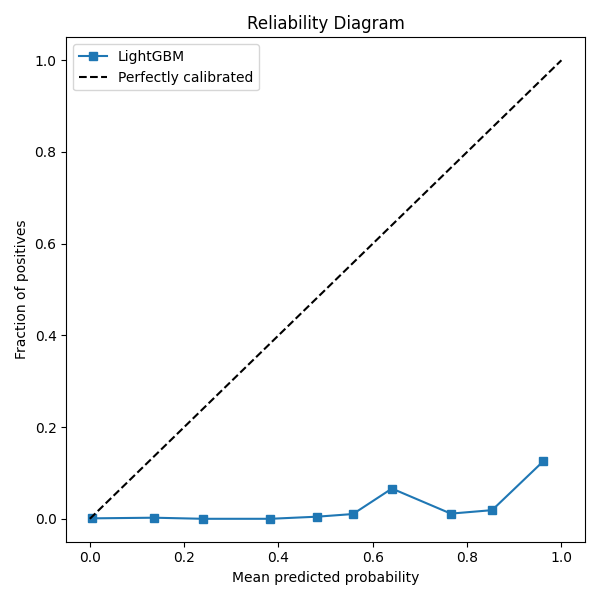
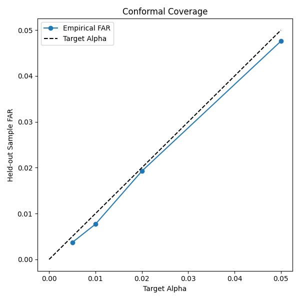
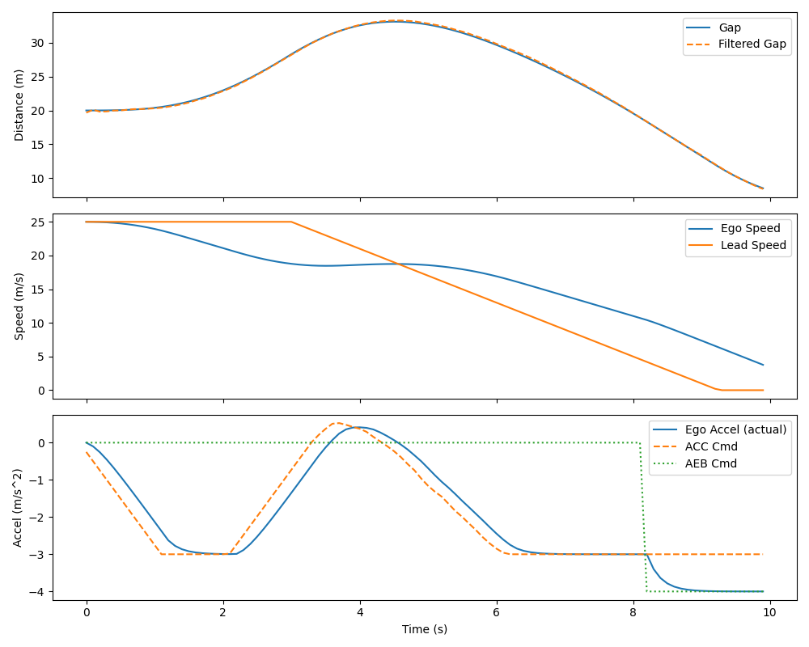
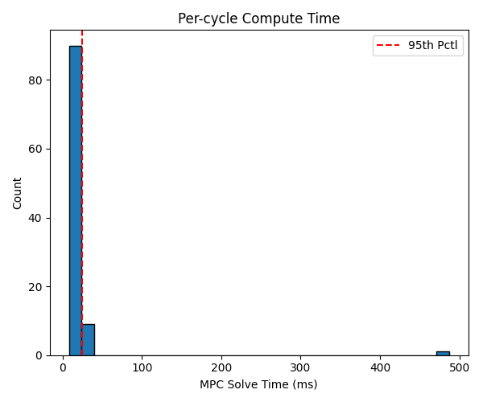

# ADAS Longitudinal Control Stack

A Python project that replays real highway trajectories through a Kalman-filter tracker, an MPC-based ACC, and a state-machine AEB whose ML trigger is conformally calibrated to a bounded false-activation rate. 

## Dataset Details (NGSIM US-101)

This project utilizes the public NGSIM (Next Generation SIMulation) US-101 dataset, which contains detailed vehicle trajectory data recorded on the US-101 highway in Los Angeles, California. The data provides high-resolution (10 Hz) vehicle positions and dynamics.

### Raw Data Attributes
The raw dataset (`trajectories-0750am-0805am.txt`) contains millions of rows representing 15 minutes of traffic. Key columns utilized include:
* `Vehicle_ID`: Unique identifier for the ego vehicle.
* `Frame_ID`: Sequential timestamp identifier (10 Hz = 0.1s dt).
* `Local_X` / `Local_Y`: Vehicle position in the local coordinate system (converted from feet to meters).
* `v_Length`: Physical length of the vehicle.
* `v_Vel` / `v_Acc`: Speed and acceleration.
* `Preceding`: The `Vehicle_ID` of the lead vehicle directly ahead in the same lane.

### Preprocessing
The data pipeline extracts continuous segments where the leader and follower stay unchanged for at least 20 seconds. It calculates the bumper-to-bumper gap by comparing the follower's `Local_Y`, the leader's `Local_Y`, and the leader's `v_Length`. Signals are smoothed using a Savitzky-Golay filter to remove noise artifacts typical in the raw NGSIM tracking algorithm.

## Overview

The project covers both ACC (Adaptive Cruise Control) and AEB (Autonomous Emergency Braking), adding a machine learning component for risk prediction alongside mathematical safety supervisors. It operates entirely on a laptop CPU using the public NGSIM dataset (offline log replay).

### Requirements Met
* **Control System Development:** MPC-based ACC with acceleration/jerk limits and speed-dependent time gaps.
* **Emergency Braking:** Four-state AEB machine (Monitor, Warn, Partial Brake, Full Brake) with hysteresis and debounce.
* **Sensing Front End:** Synthetic radar-like noise model with a constant-acceleration Kalman filter tracking the lead vehicle.
* **ML Component:** LightGBM risk predictor using split-conformal calibration bounding false activations.
* **Safety Wrapper:** Rule-based RSS-style minimum-distance supervisor that can override or veto the ML model.
* **Software Engineering:** Modular Python package, PyYAML config, `pytest` coverage, clean and typed minimal code.

## Architecture

The system runs entirely as an offline log replay. Every module reads the same Kalman-filtered lead-vehicle state; only the AEB trigger uses the ML model.

* **Shared Input:** ACC, the risk model, and the supervisor all read the *filtered* state (synthetic radar noise passed through a Kalman Filter), never the true ground-truth state.
* **ACC (MPC):** Requests a comfort-limited acceleration (down to -3 m/s²) using `cvxpy` and the `OSQP` solver.
* **AEB (FSM):** Evaluates risk. If the conformally-calibrated LightGBM model predicts a critical event within 3 seconds, it triggers warnings and then braking (up to -8 m/s²).
* **Arbitration:** An arbiter applies the lower of the two requests (AEB wins if braking). Upon AEB exit, ACC resumes but is rate-limited by the jerk limit for comfort.
* **Safety Supervisor:** Uses an RSS (Responsibility-Sensitive Safety) formulation to calculate an absolute minimum safe distance. It can *force* AEB if the gap falls below the kinematic limit, or *veto* an ML trigger if the situation is mathematically safe.

## Results & Observations

The stack was evaluated on over 1,500 real-world leader-follower trajectory pairs from the NGSIM US-101 dataset, splitting vehicles into Train (60%), Calibration (20%), and Test (20%) sets.

### 1. Risk Predictor (ML Model)
The LightGBM risk predictor was trained on rolling historical windows of the filtered state.
* **ROC AUC:** 0.917
* **PR AUC:** 0.376 (Highly imbalanced dataset, ~0.5% positive rate).





### 2. Conformal Calibration
To prevent phantom braking, we applied Split-Conformal Prediction. By targeting a strict False Activation Rate (FAR) of **1%** ($\alpha = 0.01$), the system dynamically found a tight trigger threshold of **0.9723**.
* **Observation:** The empirical FAR securely bounds the target $\alpha$, ensuring the system only triggers AEB when statistical confidence is exceptionally high.



### 3. Closed-Loop Performance (ACC + AEB)
During closed-loop stress scenarios (aggressive cut-ins and hard lead-vehicle braking):
* **MPC Latency:** Mean compute time per cycle was **23.7 ms** (95th percentile: **25.1 ms**), easily meeting the 100 ms (10 Hz) real-time requirement on a standard laptop CPU.





### 4. Ablation Studies
Running the stack across 9 severe stress scenarios yielded the following metrics (measuring total collision frames and the mean minimum gap across the scenarios):

| Mode | Collision Frames | Mean Min Gap (m) |
| --- | --- | --- |
| **Full Stack** | **69** | **1.92** |
| No Supervisor Force | 73 | 2.31 |
| No Supervisor Veto | 69 | 1.92 |
| TTC Trigger Only (No ML) | 141 | -12.93 |
| No AEB (ACC Only) | 141 | -12.93 |

**Observations:**
1. **AEB vs. No AEB:** Relying solely on the comfort-tuned ACC in emergency scenarios leads to severe crashes (min gap of -12.9m, 141 collision frames). The full stack cuts collisions in half and raises the worst-case boundary.
2. **ML + Supervisor Synergy:** The "TTC Trigger Only" baseline fails to anticipate complex dynamics. The Full Stack relies on the ML model's contextual understanding, while the "Supervisor Force" acts as a kinematic safety net when the ML model hesitates (removing it increases collisions from 69 to 73). 

## Instructions

### 1. Data Preparation
Download the NGSIM US-101 `trajectories-0750am-0805am.txt` file and place it in `data/raw/`.
```bash
python scripts/prepare_data.py
```
This extracts ~1,600 leader-follower pairs, smooths their states, and splits them by vehicle ID.

### 2. ML Training
```bash
python scripts/train_risk_model.py
```
This script adds synthetic radar noise, filters the data through the Kalman filter to mimic online conditions, extracts feature windows, and trains the LightGBM risk model.

### 3. Evaluation
```bash
python scripts/run_replay.py
python scripts/run_evaluation.py
```
This evaluates the risk model's open-loop performance, tests conformal coverage, runs closed-loop stress scenarios, logs the MPC latency, and performs component ablations. Results are saved in `results/figures/` and `results/tables/`.

## Constraints & Assumptions
* **CPU only**: No GPU, CFD, or complex vehicle-dynamics simulator used.
* **Offline Replay**: Everything runs on recorded NGSIM datasets.
* **Radar Noise Model**: Assumed Gaussian noise with 0.3m gap and 0.15m/s relative speed variance, with a 2% dropout rate.
